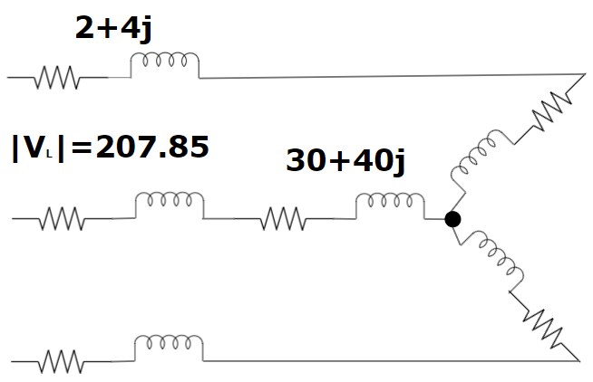
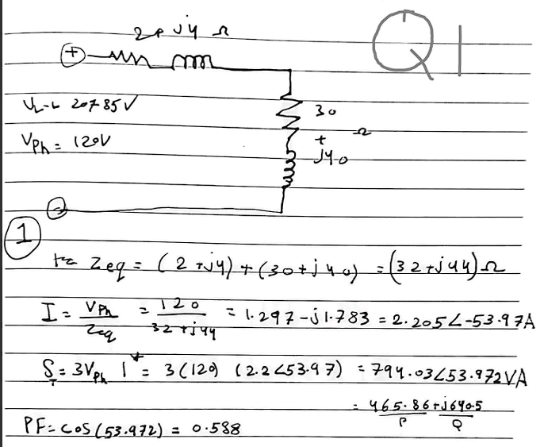
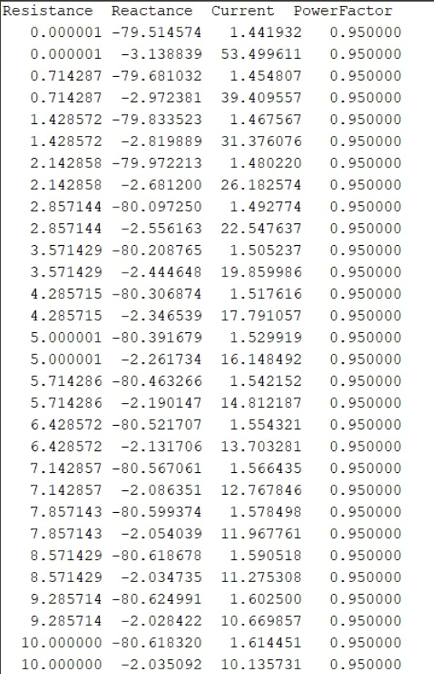
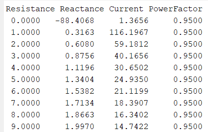
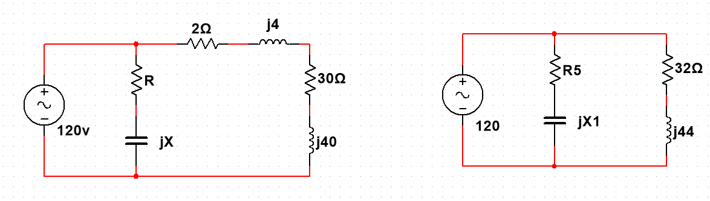

# Power-Factor Correction of a Three-Phase Motor (MATLAB)

> Electrical Power Systems I (EE 3651) term project · team project · MATLAB Symbolic Math

A three-phase Y-connected motor (**Z = 30 + j40 Ω**) is fed from a **207.85 V line-to-line** source through a line impedance of **2 + j4 Ω**. The task is to raise the power factor to **0.95** with a parallel **R-C branch** and to compare where that branch should be placed.

<p align="center"></p>

## Results

| Task | Result |
|---|---|
| Original power factor | **0.588 lagging**: I = 2.205 A per phase (V<sub>ph</sub> = 120 V, Z<sub>eq</sub> = 32 + j44 Ω) |
| R-C branch **at the load**, minimum input current | Best at R ≈ 0 Ω, X ≈ −79.5 Ω, giving **I<sub>in</sub> = 1.44 A** (about 35 % less current) |
| R-C branch at the load, **same current as before correction** | R ≈ 40.2-40.3 Ω, X ≈ −65.6 Ω, giving I ≈ 2.20 A at PF 0.95 |
| R-C branch **at the source**, minimum input current | Best at R ≈ 0 Ω, X ≈ −88.4 Ω, giving **I<sub>in</sub> = 1.37 A** |
| Capacitor connection | **Delta** is preferred: each capacitor sees V<sub>LL</sub>, which gives 3× the reactive power of a Y bank with the same capacitance |

| Hand calculation (Q1) | Sweep results, branch at load (Q2) | Sweep results, branch at source (Q5) |
|---|---|---|
|  |  |  |

<p align="center"></p>

## Method
For each value of R in a sweep, the script solves symbolically for the branch reactance X that makes the total impedance angle equal arccos(0.95). It then computes the input current and tabulates R, X, I and PF so the minimum-current solution can be chosen.

[`q3_power_factor_correction.m`](q3_power_factor_correction.m) implements the "keep the original motor current" case (Q3). It sweeps R between 40.2 and 40.3 Ω to hit I ≈ 2.205 A at PF 0.95.

```matlab
% requires Symbolic Math Toolbox
run q3_power_factor_correction.m
```

## Load-side vs. source-side correction
- **At the load:** compensates the motor locally, reduces line current and losses, and suits individual loads.
- **At the source:** compensates the whole circuit including the line, gives slightly lower input current, needs a larger central bank, and suits systems with many loads.
